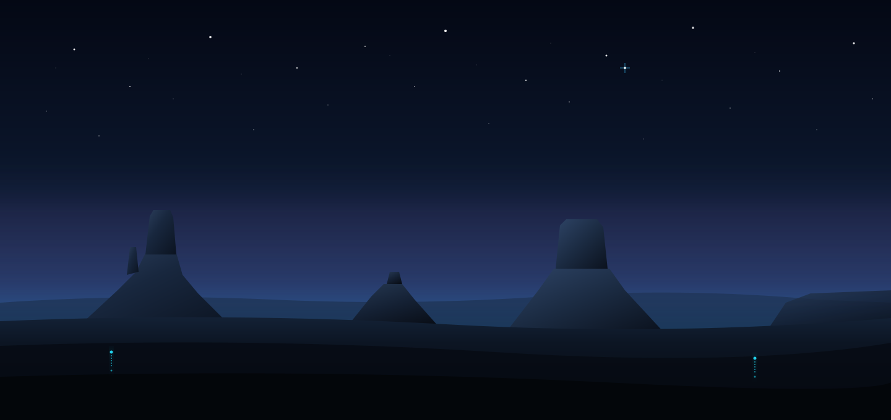

# Night Trips (NT) — Surreal Nocturnal Expeditions



> **Night Trips** curates surreal nocturnal journeys through the world's most breathtaking untouched landscapes, where silence meets starlight and the cosmos unfolds. Stargazing desert camps, midnight canyon traverses, and celestial explorations under pristine dark skies.

---

## 🚀 Live Demo & Deployment
- **GitHub Repository**: [https://github.com/soxibs48-eng/amaliy10](https://github.com/soxibs48-eng/amaliy10)
- **Vercel 1-Click Deploy**: [](https://vercel.com/new/import?s=https%3A%2F%2Fgithub.com%2Fsoxibs48-eng%2Famaliy10)

---

## 🎨 Design & Figma Specification
Pixel-perfect implementation based on the Figma UI/UX specification:
`https://www.figma.com/file/9VW6sCP0WSnxEDiHy8nqNI/NT?type=design&node-id=0%3A1&mode=design&t=v867Xtr9j4LgYpuY-1`

### Visual Identity & Palette:
- **Midnight Deep Canvas**: `#050811` & `#0A1120`
- **Atmospheric Navy / Cards**: `#0F1A2D` & `rgba(14, 25, 44, 0.75)`
- **Vibrant Cyan / Glow Accents**: `#22D3EE` & `#00F2FE`
- **Soft Sky Accent**: `#38BDF8` & `#818CF8`
- **Pure White Display Text**: `#FFFFFF` & `#E2E8F0`
- **Typography**: `Playfair Display` (Headings & Luxury Serif), `Plus Jakarta Sans` (UI & Body)
- **Atmospheric Visuals**: Vector-rendered Monument Valley twilight landscape with starfield and cyan beacons.

---

## 🌟 Key Features & Components

1. **Header & Navigation**:
   - Modern glassmorphic sticky header with backdrop blur.
   - Interactive ambient night breeze audio synthesizer (Web Audio API).
   - Instant "Book Trip" modal trigger.
   - Mobile-responsive slide-over navigation drawer.

2. **Hero Section**:
   - Display typography: *"Night Trips"* with subtitle *"A unique trip for everyone"*.
   - Layered Monument Valley twilight landscape with stellar star flare and glowing beacons.
   - Numerical slide indicator `01 / 04` and animated scroll prompt.

3. **"Pick your trip" Section**:
   - Tab category filtering (`REGULAR`, `CHILL`, `EXTREME`, `CUSTOM`).
   - Dynamic slide switcher with duration, group size, difficulty, and price per guest.
   - Prev/Next controls with keyboard arrow navigation (`←` / `→`).
   - Cyan dot matrix decorative accent grid.

4. **"About Us" Section**:
   - Philosophy and story of Night Trips founded on zero light pollution advocacy.
   - Trust metrics: `120+` Expeditions, `99.4%` 5-Star Reviews, `0%` Light Pollution.
   - 4-photo team composition matching the Figma layout:
     - Alex Carter (Founder & Master Navigator) with pill badge
     - Elena Vance (Astrophotographer & Field Guide)
     - Marcus Cruz (Wilderness Safety & Medic)
     - Maya Lin (Camp Experience Curator)

5. **"People's thoughts" (Testimonials)**:
   - 4 dark glassmorphic review cards with quotation marks, feedback, and verified author profiles.

6. **"See you soon!" & Newsletter**:
   - Call to action with seasonal astronomical alerts subscription and toast confirmation.

7. **Master Footer**:
   - 5 structured navigation columns (Services, Trips, About, Safety & FAQ, Socials).
   - Centered `NT.` luxury brand emblem and copyright.

8. **Interactive Booking Modal**:
   - Dynamic expedition selection, guest count, real-time total price calculation, and reservation toast notifications.

---

## 🛠️ Tech Stack
- **HTML5**: Semantic, accessible (a11y), SEO-optimized.
- **CSS3**: Custom design tokens, glassmorphism, responsive CSS grid and flexbox layout.
- **JavaScript (Vanilla)**: High performance, zero external framework dependencies, Web Audio API synthesizer.
- **SVG Graphics**: Fully scalable vector assets crafted for Retina displays.

---

## 💻 Local Development
To run this project locally:
```bash
# Clone the repository
git clone https://github.com/soxibs48-eng/amaliy10.git

# Navigate into directory
cd amaliy10

# Open with VS Code and Live Server, or launch with Python:
python -m http.server 5500
```
Open [http://localhost:5500](http://localhost:5500) in your browser.
